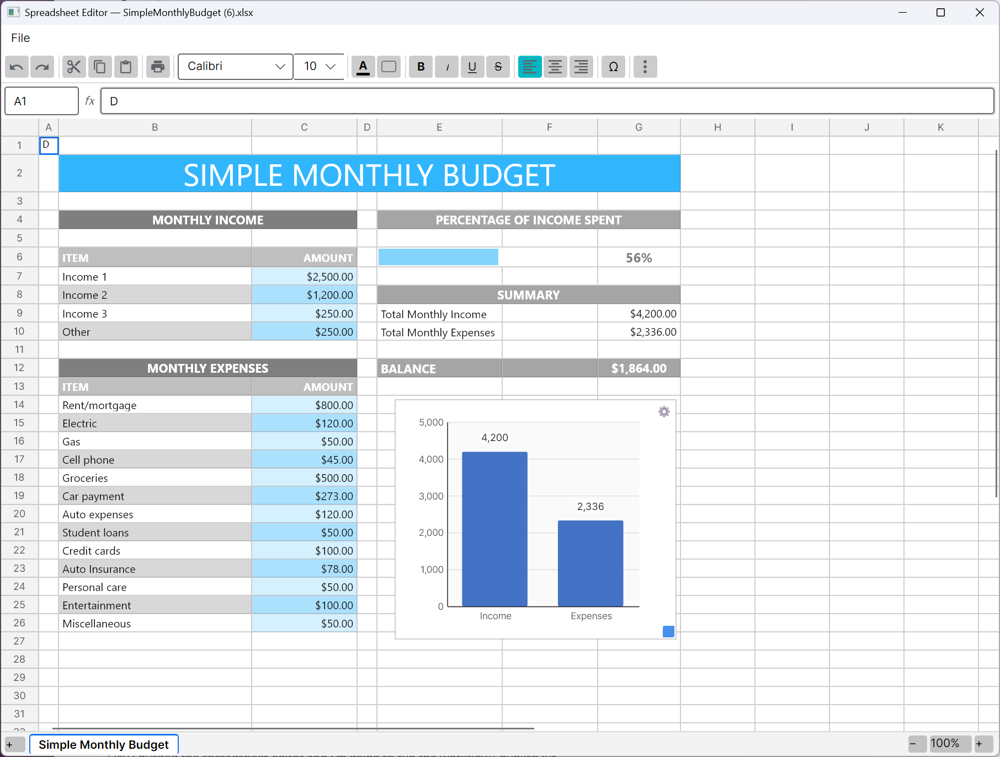

# AvaloniaControls.SpreadsheetEditor

An Excel-like **spreadsheet editor control for [Avalonia UI](https://avaloniaui.net/)**, published as the
NuGet package [`Devolutions.AvaloniaControls.SpreadsheetEditor`](https://www.nuget.org/packages/Devolutions.AvaloniaControls.SpreadsheetEditor).

<p align="center">
  
</p>

> [!IMPORTANT]
> **This control requires a commercial [Avalonia UI (Accelerate)](https://avaloniaui.net/) license.**
> It builds on the paid `Avalonia.Controls.RichTextEditor` and `Avalonia.Controls.Charts` packages, which
> need a valid license key at build time. The source is MIT-licensed, but you **cannot build or run** the
> control (or an app that consumes it) without your own Avalonia license. See [Requirements](#requirements).

It uses a custom rendering grid (not the Avalonia `DataGrid`) so cells can merge and host rich content:

- Custom grid with cell merging, frozen headers, drag-to-select, and infinite rows/columns.
- Rich in-cell editing (bold / italic / underline / strikethrough, fonts, colors, alignment).
- A hand-rolled `=` formula engine (arithmetic, ranges, `SUM/AVERAGE/IF/…`, named ranges, live recalc).
- Charts, multi-sheet tabs, undo/redo, clipboard, a symbol picker, and printing (cross-platform PDF
  export, a native Windows print dialog, and `lpr`/CUPS on Linux/macOS).
- An integration API modeled on Avalonia's `RichTextEditor` (`IsReadOnly`, `Undo`/`Redo`, `CanUndo`/`CanRedo`,
  `SelectAll`, `SelectedRange`, and `ContentChanged` / `SelectionChanged` / `IsReadOnlyChanged` events).

## Repository layout

| Path | Description |
|------|-------------|
| `SpreadsheetEditor.Controls/` | The reusable control library (the NuGet package). |
| `SampleApp/` | A sample desktop host app demonstrating the control (open/save `.xlsx`, print, …). |
| `Common.props`, `Directory.Build.props` | Shared build settings, dependency versions, and license handling. |

## Requirements

This control depends on the commercial **Avalonia Accelerate** packages
(`Avalonia.Controls.RichTextEditor`, `Avalonia.Controls.Charts`). Building it — and any app that consumes
it — requires a valid **Avalonia UI license key**. See <https://avaloniaui.net/>.

## Building locally

Provide your Avalonia license key via a git-ignored `.env` file at the repository root:

```
AVALONIA_LICENSE_KEY=your-key-here
```

(Alternatively set an `AVALONIA_LICENSE_KEY` environment variable.) Then:

```bash
dotnet build SpreadSheetEditor.sln
dotnet run --project SampleApp        # launch the sample app
dotnet pack SpreadsheetEditor.Controls -c Release   # build the NuGet package
```

## Using the control

Add the required theme includes to your `App.axaml` (alongside `FluentTheme`):

```xml
<Application.Styles>
    <FluentTheme />
    <StyleInclude Source="avares://Avalonia.Controls.RichTextEditor/Themes/Default.axaml" />
    <StyleInclude Source="avares://Avalonia.Controls.Charts/Themes/Default.axaml" />
</Application.Styles>
```

Then place the control:

```xml
xmlns:se="clr-namespace:SpreadsheetEditor.Controls;assembly=SpreadsheetEditor.Controls"
...
<se:SpreadsheetEditor x:Name="Editor" />
```

## License

MIT — see [LICENSE](LICENSE).
